# Detailed Curriculum

## Program goal

Develop the ability to design, build, evaluate, secure, and operate applied AI systems as a software engineer. The main learning vehicle is one research-intelligence product, supported by small experiments. The goal is not to train a foundation model or collect framework badges.

The curriculum assumes full-stack engineering experience and some exposure to AI. Python, LLM system design, evaluation, retrieval, security, and deployment are taught through implementation. React/TypeScript, Java/Spring, Kafka, and Flink are depth branches because the planning conversation named them as interests; prioritize them according to target roles.

## Operating assumptions

- **Length:** 24 weeks (six months).
- **Pace:** 10 focused hours per week (about 240 hours); stretch the calendar without changing the sequence.
- **Project:** Research Intelligence, initially a bounded public-document research assistant. Confirm user and domain at the Week 8 gate.
- **Language:** Python for AI/application services. Keep TypeScript as a UI option. Add Java/Spring only after a role review or architectural need.
- **Learning mix:** roughly 20% reading, 20% guided experiments, 40% independent implementation, 15% evaluation/debugging, 5% reflection.
- **Source policy:** public or explicitly licensed material; track provenance; exclude employer/customer/private data and secrets.

## Prerequisites and week-one diagnostic

Measure, do not assume: Python environment/imports; tests; HTTP/JSON; SQL; Git branches/commits; basic model API usage; reading stack traces; and explaining a system diagram. For each, record one task you can do alone and one gap. If Python/API basics are already strong, verify them briefly and deepen data modeling or evaluation; keep the evidence artifacts.

## Learning sequence

```mermaid
flowchart LR
  A[Python, tests, packaging] --> B[HTTP, API, relational data]
  B --> C[Model adapter and structured output]
  C --> D[Evaluation before feature expansion]
  D --> E[Document ingestion and lexical search]
  E --> F[Embeddings and hybrid retrieval]
  F --> G[Cited RAG product]
  G --> H[Observability, reliability, security]
  H --> I[Tool workflow and MCP]
  I --> J[Async/distributed extension]
  J --> K[Deploy, operate, communicate]
```

## Module A — Engineering foundations (Weeks 1–4)

**Outcome:** a maintainable Python service another developer can install, run, test, and understand, with explicit data contracts and relational persistence.

**Syllabus:** Python layout/imports, virtual environments, dependency pinning, package metadata, CLI entry points; type hints, dataclasses/Pydantic, iterators, context managers, exceptions, `pathlib`, JSON/text I/O; pytest, fixtures, parameterized tests, mocking boundaries, lint/format/type checks, logging, environment config and secret hygiene; HTTP lifecycle/status codes/idempotency/pagination/validation/error envelopes/OpenAPI; SQL keys/constraints/joins/indexes/transactions/migrations; separation of domain logic from I/O.

**Lab sequence:**

1. Tested CLI reads JSON, validates records, handles malformed lines, and reports a useful summary.
2. FastAPI service exposes create/list/get endpoints with validation and stable errors.
3. Add PostgreSQL persistence and migrations; prove failed writes do not leave partial state.
4. Add structured logs, configuration, CI checks, and a setup guide.

**Exit standard:** clean setup works from README; success and failure paths are tested; API schema is visible; schema changes are reproducible; logs distinguish user errors from operational failures. Evidence goes in `labs/python/`.

## Module B — LLM application engineering (Weeks 5–8)

**Outcome:** integrate one hosted or local model behind a narrow interface, measure a baseline, and distinguish model behavior from application behavior.

**Syllabus:** tokens/context windows, sampling, structured output, embeddings conceptually, model capability/latency/cost; timeouts, retries with jitter, rate limits, cancellation, error classification and response parsing; task specification, instructions vs data, context selection, schemas and abstention; baseline quality, hand-labeled examples, prompt/model/config versioning, traces; user/job-to-be-done/current workaround/success/non-goals/data licensing; deterministic evaluation checks, human review, judge calibration.

**Lab sequence:**

1. Wrap a provider behind `generate(request) -> response`; exercise timeout, malformed response, and rate limit behavior.
2. Build a structured extraction or summarization task over a tiny fixed dataset.
3. Create 20–30 representative cases, label expected properties, measure baseline, and review misses.
4. Compare one prompt change and one model/config change separately; record cost and latency.
5. Write product brief and freeze the Week 8 MVP boundary.

**Exit standard:** recorded baseline, versioned cases, observable provider failures, and one-page scope brief. No agent or RAG complexity before this gate.

## Module C — Data, retrieval, and RAG (Weeks 9–12)

**Outcome:** create a reproducible, source-aware document pipeline and show when retrieval methods improve answer quality.

**Syllabus:** public/licensed corpus, terms, provenance, coverage and deduplication; parsing, normalization, chunking, metadata, checksums, incremental reprocessing and quarantine; lexical ranking, filters, semantic embeddings, vector distance, hybrid retrieval and reranking; context budgeting, citation IDs, answer schemas, abstention and source coverage; query sets, relevance labels, precision/recall at k or reciprocal rank, evidence coverage and citation correctness.

**Lab sequence:**

1. Import 20–50 documents from one bounded public collection; retain source/license metadata and parser diagnostics.
2. Implement lexical search and label 15–25 realistic queries with relevant passages.
3. Add embeddings and compare top-k retrieval with the lexical baseline.
4. Generate answers from selected passages; require citation mapping and no-answer behavior.
5. Review failures and add important misses as regressions.

**Exit standard:** corpus can be rebuilt, provenance retained, retrieval measured, citations resolve, and app abstains without evidence. Keep the simpler retriever unless results justify complexity.

## Module D — Product quality, security, and operations (Weeks 13–16)

**Outcome:** make the research flow diagnosable and robust; identify and mitigate threats before expanding capabilities.

**Syllabus:** search/inspect/compare/save-export workflow; regression datasets and failure taxonomy; traces across request → retrieval → model, structured logs, request IDs, latency/cost/error metrics and privacy-aware retention; bounded retries/timeouts, backpressure, caching, concurrency, graceful degradation and recovery; prompt injection in retrieved documents, sensitive data, unsafe rendering, authorization, dependency/model provenance, secrets and audit trails; safe fallback and no consequential writes.

**Lab sequence:**

1. Add traces to explain one bad answer from request through retrieval to output.
2. Add adversarial documents and queries: injection, conflicting evidence, empty corpus, oversized file, malformed text.
3. Write threat model with assets, trust boundaries, abuse cases, mitigations, residual risks.
4. Exercise provider outage and recovery; establish initial latency/cost baseline.
5. Request a product review if available; prioritize only evidence-backed changes.

**Exit standard:** important failures reproduce and have tested handling; retrieved content is untrusted; traces avoid secrets; threat model and residual risks are documented.

## Module E — Agents, MCP, and distributed systems (Weeks 17–20)

**Outcome:** understand deterministic workflows versus agent-directed actions, then build bounded tool use only if it improves a measured task.

**Syllabus:** state machine/graph vs model-directed tool choice; stopping criteria, state, approvals and containment; narrow tool schemas, validation, least privilege, side effects, idempotency, timeout/cancellation and budgets; MCP client/server, tools/resources/prompts, transports/lifecycle/versioning/consent/trust; agent evals for success, tool choice/arguments, unnecessary calls, policy violations, loops, cost and latency; optional queues, at-least-once delivery, idempotency, retries/dead letters, ordering, schema evolution, Kafka/Flink concepts.

**Lab sequence:**

1. Implement the research flow deterministically and identify where a model decision might help.
2. Compare deterministic and one-tool agent approaches with the same eval set.
3. Build a local read-only MCP integration if interoperability benefits the workflow; document permissions.
4. Evaluate invalid arguments, unavailable tools, injection, loops, budget exhaustion and cancellation.
5. Optional: move ingestion to a background queue; prove idempotency and duplicate-delivery recovery.

**Exit standard:** decision record justifies agent use or deferral. Any agent has narrow access, budgets, failure handling and evals. Distributed systems remain optional unless user need or target roles justify them.

## Module F — Deployment, portfolio, and career evidence (Weeks 21–24)

**Outcome:** ship a reproducible demo, demonstrate quality/security/operability, and explain the design clearly.

**Syllabus:** package/container basics, development/production config, secrets, migrations, health checks; CI for lint/type/unit/integration/eval smoke/security checks; low-cost deployment and teardown; runbook, logs/metrics, backup/recovery, cost/latency guardrails; architecture diagram, decisions, evaluation report, threat model, demo narrative and limitations; target-role review and interview story.

**Exit standard:** independent reviewer can run/view the app, inspect evidence, understand limits, and hear two technical trade-offs. Produce a 90-day follow-on plan.

## Extensions after the core program

Select based on current role descriptions, not breadth anxiety:

- **ML engineering:** probability/statistics, PyTorch, fine-tuning, experiment tracking, model serving.
- **AI platform/LLMOps:** Kubernetes, model gateways, observability, policy controls, tenant isolation and scaling.
- **Enterprise Java:** Spring Boot and Spring AI; port a narrow service boundary and compare operations.
- **Data/streaming:** Kafka, Flink state/event time, backfills, schema registry and data quality.
- **Frontend:** React/TypeScript streaming UX, accessibility, state management and source inspection.

## Completion checklist

- [ ] Core weekly outcomes and gates have evidence.
- [ ] Product is reproducible and scoped to one real user workflow.
- [ ] Evaluation covers success, no-answer, failures and adversarial inputs.
- [ ] Security boundaries and data provenance are visible.
- [ ] Deployment/runbook and limitations are documented.
- [ ] Skill matrix and next-quarter plan are updated.
