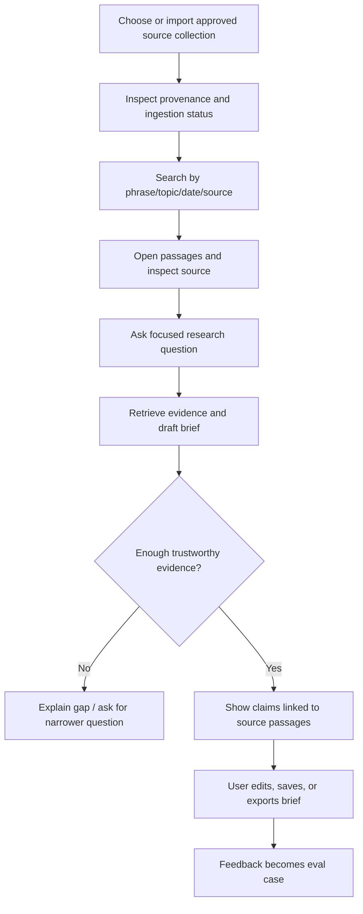

# Product Portfolio and Flagship Project Brief

## Flagship concept: Research Intelligence

**Status:** Detailed hypothesis for discovery, not yet an approved product specification. The shared planning chat suggested a cross-domain intelligence platform beginning with research intelligence. This document narrows that into a learning project so it can be tested and revised before major implementation.

### Problem hypothesis

People doing desk research spend time finding relevant documents, checking evidence across sources, and reconnecting summary claims to the underlying material. A bounded research assistant could help search a curated collection and draft a cited, reviewable brief. The product should improve evidence-finding and synthesis, not pretend to replace expert judgment.

### Candidate first user

Start with one person doing repeated research over public documents: the user themself, a defined analyst/researcher persona, or another chosen group. Week 8 discovery must confirm which. Do not design simultaneously for every domain or audience.

### Candidate user flow

### MVP sequence

1. **Corpus and provenance:** one public/appropriately licensed collection, documented source rules, source manifest, and reproducible ingestion.
2. **Search before generation:** lexical search, filters, passage inspection, and stable source IDs.
3. **Measured retrieval experiment:** labeled queries compare lexical against embedding/hybrid retrieval; retain the simpler baseline unless improvement is clear.
4. **Grounded answer:** retrieve passages, generate a structured brief, map claims/citations to passages, and abstain if evidence is insufficient.
5. **Review workflow:** user inspects, edits, saves/exports, and can report a wrong citation or missing source.
6. **Trust and operations:** eval suite, trace, cost/latency report, threat model, recovery instructions.
7. **Optional tool integration:** read-only MCP or bounded agent only if it improves a measured task and passes its own security/evaluation gate.

### Explicit non-goals for the six-month MVP

- Autonomous internet crawling, account login, email/messaging, purchases, or other external side effects.
- Multiple specialized agents, multi-agent coordination, or open-ended autonomy.
- Fine-tuning a foundation model, training an embedding model, or serving a large model from custom GPU infrastructure.
- Supporting all file formats, languages, domains, organizations, and real-time streams.
- Claiming professional, legal, financial, medical, or other expert advice.

### Success measures (set thresholds after baseline)

- **Usefulness:** a reviewer can complete the chosen research task with less evidence-finding effort than the stated baseline.
- **Retrieval:** relevant passages appear in the selected top-k results at an agreed rate on the labeled query set.
- **Grounding:** material claims have valid citations; unsupported claims and citation mismatches are counted.
- **Abstention:** system identifies missing evidence on no-answer cases rather than inventing a confident result.
- **Reliability:** ingestion and answer failures are visible and recoverable in the chosen demo environment.
- **Security:** untrusted document instructions do not gain authority; data and tool boundaries are documented and tested.
- **Operability:** each demo result can be traced to corpus, code/config, and model version without exposing secrets.

Do not choose numeric thresholds by intuition alone. Record the baseline first, then agree on a meaningful improvement and acceptable error severity.

### Candidate architecture and learning rationale

| Component | Initial option | Why it is in the learning path | When to change it |
| --- | --- | --- | --- |
| API/service | Python + FastAPI | Efficient path to typed HTTP services and application logic | Target role or system boundary demands Java/Spring |
| Metadata/search | PostgreSQL full-text search | Starts with familiar relational constraints and a clear baseline | Corpus/scale/query needs show a limitation |
| Semantic search | pgvector, optional | Compares semantic retrieval without immediately adding another datastore | Scale/latency/operations evidence justifies a dedicated store |
| Model access | Provider adapter | Makes model choice explicit and keeps domain logic portable | Provider-specific capability is valuable and documented |
| Evaluation | Local versioned harness + pytest checks | Reproducible and portable; avoids dependence on a changing platform | Hosted tools add value without replacing exportable cases |
| UI | API/CLI first; React/TypeScript later | Validates the workflow before investing in polish | A reviewer needs UI to evaluate product value |
| Tool protocol | MCP optional | Demonstrates interoperability and tool boundaries | Only if the use case needs an external client/server |
| Async processing | Queue optional | Teaches distributed systems through a real workload | Ingestion volume, retries, or user latency requires it |

### Decisions to resolve by Week 8

1. Which first user and recurring task are worth solving?
2. Which domain and public corpus are both useful and safe to use?
3. Is the product's value search, comparison/synthesis, monitoring, or drafting?
4. What baseline workflow and measure define improvement?
5. What target role and geography should influence optional technologies?
6. What interface is enough for a credible demonstration?

## Supporting portfolio pieces

Build at most one or two, and reuse them in the flagship when useful.

| Piece | Demonstrates | Roadmap slot | Deliverable |
| --- | --- | --- | --- |
| Evaluation harness | Dataset design, scoring, regression analysis | Weeks 6–7 | Repeatable run and readable report |
| Retrieval benchmark | Lexical vs semantic/hybrid ranking | Weeks 10–12 | Labeled query set, comparison, decision record |
| MCP read-only server | Protocol/schema design, least privilege, failure handling | Weeks 18–19 | Local tool, permissions and test transcript |
| Async ingestion extension | Queue semantics, idempotency, retries, event processing | Optional Week 20 | Duplicate/retry experiment and architecture note |

## Portfolio presentation standard

Each published project includes: user/problem, setup/run steps, architecture diagram, data provenance, automated checks/evaluation summary, threat model, deployment or local demo path, limitations, and a short demo script. The first paragraph should state what works today and what does not. Avoid vague claims such as “hallucination-free” or “production-ready.”
