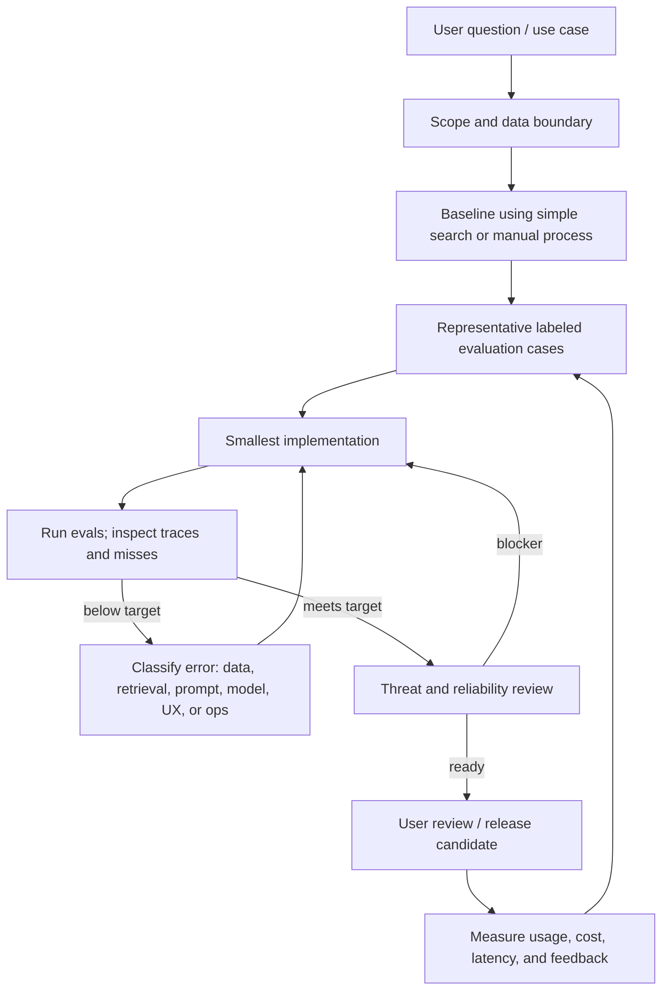

# Program Flow and Working Method

This file explains how the curriculum, labs, flagship project, reviews, and career evidence fit together. The [24-week roadmap](ROADMAP.md) is the schedule; the [curriculum](CURRICULUM.md) explains what to learn and why.

## End-to-end learning flow

```mermaid
flowchart LR
  A[Baseline and target role] --> B[Engineering foundations]
  B --> C[LLM feature with a measured baseline]
  C --> D[Product problem and data boundary]
  D --> E[Ingestion and search]
  E --> F[RAG and citations]
  F --> G[Evaluation and error analysis]
  G --> H[Security and reliability]
  H --> I[Bounded tools / MCP if justified]
  I --> J[Deployment and operations]
  J --> K[Portfolio evidence and career review]
  G -->|failed criterion| F
  H -->|risk not mitigated| G
  K -->|new role requirements| A
```

Each capability follows: **problem → baseline → small implementation → evaluation → failure analysis → revision → documented decision**. Add a framework, vector database, or agent only after evidence shows a need.

## Workstreams

| Workstream | Main weeks | Contribution |
| --- | --- | --- |
| Engineering craft | 1–4, 21–22 | Reproducible Python, API/data design, tests, CI, deployment and operations |
| Applied AI | 5–8 | Provider boundary, structured outputs, context design, task-specific evaluation |
| Research product | 8–16 | User problem, corpus, ingestion, lexical and semantic search, cited answers |
| Trust and reliability | 7, 13–16, 19, 22 | Evals, observability, failure handling, security boundaries, cost and latency control |
| Tool-use systems | 17–20 | Deterministic workflows, MCP, constrained orchestration, asynchronous processing |
| Portfolio and career | 1, 8, 12, 16, 20, 23–24 | Evidence, role-market review, narrative, demo, next plan |

## Weekly cadence (10-hour baseline)

| Session | Time | Activity | Required output |
| --- | ---: | --- | --- |
| A. Learn | 1.5 h | Read the assigned primary source; write notes and questions | Short concept note |
| B. Guided experiment | 2 h | Reproduce one small example; change one variable | Working experiment and observation |
| C. Independent build | 3 h | Implement the roadmap slice in a lab or the product | Code, diagram, or decision record |
| D. Verify | 2 h | Add/run tests or evals; inspect failures and logs | Evidence artifact and issue list |
| E. Review | 1.5 h | Explain what changed, record the lesson, plan next session | Learning-log entry and progress update |

If a week is missed, resume at the next incomplete outcome. Do not compress two weeks by skipping verification or write-up. With less time, stretch the calendar; with more time, deepen experiments rather than adding unrelated tools.

## Artifact path

1. Curriculum concept → concise note in `notes/concepts/`.
2. Small exercise → isolated, named lab in `labs/python/`, `labs/rag/`, `labs/mcp/`, or `labs/agents/`.
3. Reusable feature → flagship project only when it supports the agreed user workflow.
4. Evidence → tests, labeled examples, evaluation results, decision records, demo notes.
5. Reflection → `progress/LEARNING_LOG.md`, `PROGRESS.md`, and monthly skill-matrix update.

Avoid copying whole tutorials into the project. Record what you learned, tested, and decided.

## Project delivery loop

## Monthly review and replanning

At Weeks 4, 8, 12, 16, 20, and 24:

1. Re-run the prior gate’s checks.
2. Update the skill matrix from concrete artifacts.
3. Review 8–12 current job descriptions for the intended role/geography; capture repeated responsibilities, not every keyword.
4. Choose one gap that changes the next month’s work. Defer the rest.
5. Revisit scope, weekly hours, and relevant resource versions.

## Completion definition

The program produces a coherent evidence set: a reproducible applied-AI product, meaningful evaluation suite, clear data provenance, architecture and threat model, observable failure behavior, runnable demo, and an honest account of limitations. Finishing videos or collecting certificates alone does not satisfy the outcome.
